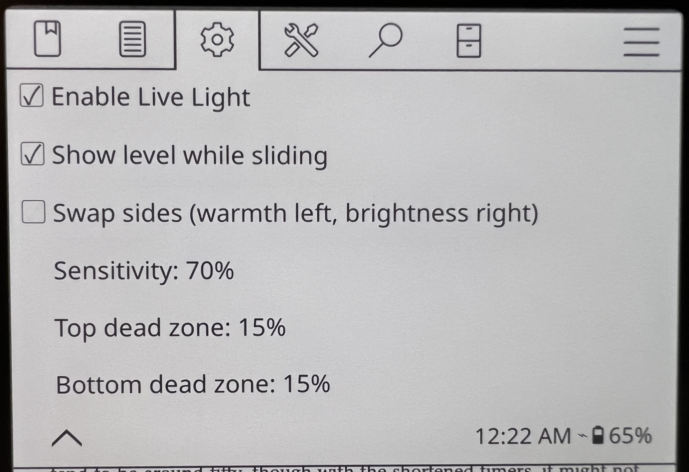

# Live Light

A KOReader plugin that makes the brightness and warmth edge swipes behave the way they do in Kobo's own software: the light changes **while your finger is moving**, not after you lift it.

- Slide up or down the **left edge** of the screen for brightness.
- Slide up or down the **right edge** for warmth.
- A small box shows the level as you go.

| Brightness | Warmth |
|:---:|:---:|
|  |  |
|  |  |

Top row: a [Bookshelf](https://github.com/AndyHazz/bookshelf.koplugin) home screen. Bottom row: while reading.

## Tested on

Developed and tested on a **Kobo Clara BW** running **KOReader 2026.07.02**, which is the only setup it has been tried on.

It should theoretically work on any touch device where KOReader can control the frontlight, but that is untested. Reports from other devices are welcome.

Devices without a warmth light get brightness on the left edge only (or the right edge, if you turn on swap sides). The other edge is left alone.

## Install

1. Download `livelight.koplugin.zip` from the [Releases](../../releases) page and unzip it. You should have a folder named `livelight.koplugin`.
2. Connect your e-reader to a computer with USB.
3. Copy the `livelight.koplugin` folder into KOReader's `plugins` folder. On a Kobo that is `.adds/koreader/plugins/`. The `.adds` folder is hidden: on a Mac, press **Cmd+Shift+.** in Finder to show it.
4. Eject the device and restart KOReader.

If you already have edge-swipe settings set up, you do not need to change or disable them. Live Light takes priority over KOReader's built-in edge swipes while it is switched on, and hands the edges back when it is switched off.

To uninstall, delete the folder.

## Using it

Put a finger on the left or right edge of the screen (the outer eighth) and slide up or down. Start moving right away. If you rest your finger for about half a second, KOReader treats it as a long-press.

- At the default sensitivity, about 70% of the screen height covers the full range. This is adjustable in [Settings](#settings).
- Slides that start in the top or bottom 15% of the screen are left to KOReader, so swiping down from the top or up from the bottom still opens its menus. This is adjustable in [Settings](#settings).
- Sliding brightness all the way down turns the light off; sliding back up turns it on.
- Once a slide has started, your finger can wander off the edge strip and it keeps working until you lift.

> [!IMPORTANT]
> **NOTE:** After you leave a book, this plug-in does not work on Bookshelf's shelf screens until the book is actually no longer in memory, which happens soon but not immediately. **THIS IS NOT IDEAL BUT IS NOT A BUG.**
>
> When you leave a book, Bookshelf actually keeps it open in the background for a while. During this time, Bookshelf disables certain features until the device has gone untouched for 30 to 40 seconds, or you open a different book. There are good reasons for this, but it has the side effect of making this plug-in not work during this period. Bookshelf would need to be modified to allow these swipes through while a book is in memory.

### Settings

Top menu → gear icon → Taps and gestures → Live Light:

- **Enable Live Light**: the main on/off switch.
- **Show level while sliding**: show or hide the box with the number.
- **Swap sides (warmth left, brightness right)**: off by default. Turn it on to put warmth on the left edge and brightness on the right.
- **Sensitivity**: how far the light changes for a given slide, from 50% to 200% (default 100%). Higher means a shorter slide covers the full range; lower gives finer control.
- **Top dead zone** and **Bottom dead zone**: the share of the screen height, from 0% to 40% (default 15% each), at the top and bottom where Live Light ignores slides so they do not collide with KOReader's own top and bottom swipes. Set to 0% to turn one off.

## Where it works

Tested on the device:

- **While reading a book.**
- **[Bookshelf](https://github.com/AndyHazz/bookshelf.koplugin) home screens**.

It deliberately stays out of full-screen viewers such as the image viewer.

And it has the limitation mentioned above about not working in Bookshelf's main shelf screens while a book is still in memory.

## Credits

Written by David Friedman, working with [Claude](https://claude.com/claude-code), Anthropic's AI model.

## License

[AGPL-3.0](LICENSE), the same license as KOReader.